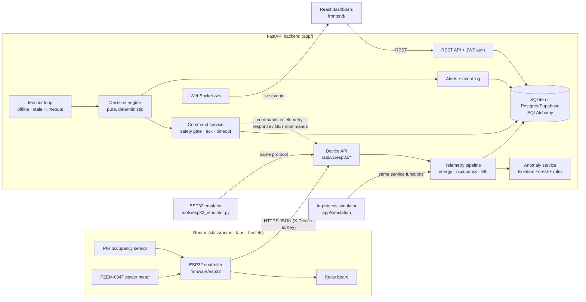
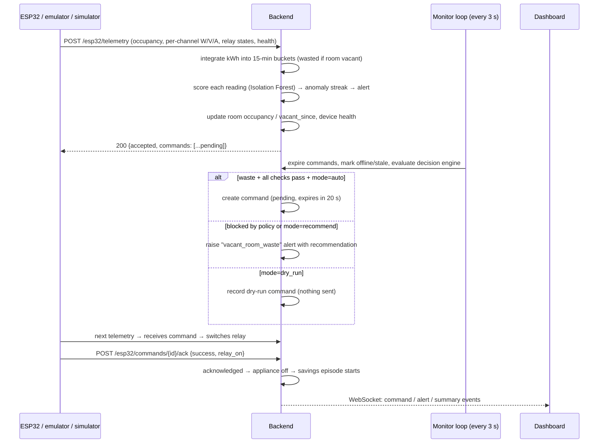
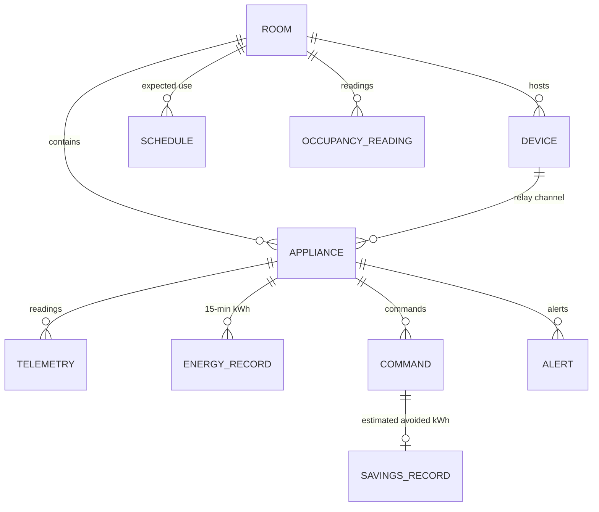

# Architecture

## System overview

## Deployment topology

Local: one machine (Docker Compose or dev servers) with SQLite. Cloud (free, no card): Vercel serves
the dashboard, a Hugging Face Docker Space runs the long-lived FastAPI process, Supabase hosts Postgres — see
[DEPLOYMENT.md](DEPLOYMENT.md). The same code runs in both; only `DATABASE_URL` and
`VITE_API_URL` differ.

## Backend modules

| Module | Responsibility |
|---|---|
| `app/config.py` | Environment configuration (pydantic-settings). Security switches live **only** here. |
| `app/models.py` | ORM: users, rooms, devices, appliances, telemetry, occupancy readings, energy records (15-min buckets), savings records, schedules, alerts, commands, event log, settings, ML model registry. |
| `app/services/energy.py` | Pure energy maths: trapezoidal kWh, bucket splitting, tariffs (flat + time-of-use), carbon, savings estimate. |
| `app/services/telemetry.py` | Ingestion pipeline shared by HTTP devices and the simulator. |
| `app/services/decision_engine.py` | Pure, deterministic decision function with full explanations. |
| `app/services/automation.py` | Builds decision inputs from the DB, executes decisions (alerts, dry-run/real commands). |
| `app/services/commands.py` | Safety gate, queueing, delivery, acknowledgement, timeouts, savings episodes. |
| `app/services/monitor.py` | Periodic supervision: device offline detection, stale data, command timeouts, override expiry, savings cap, automation. |
| `app/services/analytics.py` | Dashboard aggregates and history series. |
| `app/ml/` | Features, synthetic data generator, Isolation Forest training/evaluation, rule fallback, thread-safe model holder. |
| `app/adapters/` | Device command transports (ESP32 HTTP pull, simulated) and sensor payload parsers (`seg.v1`, `compact.v1`). |
| `app/simulation/` | Appliance power profiles, simulator (virtual ESP32s with scenarios), history backfill. |
| `app/api/` | REST routers + auth dependencies. |
| `app/context.py` | Wires shared services; event bus publishing WebSocket messages **after DB commit**. |

## Telemetry → decision → command sequence

## Data model (simplified)

Every telemetry, occupancy, energy and savings row carries `source` ∈ {`simulation`, `emulator`,
`hardware`}, derived server-side from the registered device kind — never from the payload.

## Concurrency

* FastAPI sync endpoints run in a thread pool; SQLite runs in WAL mode with a busy timeout.
* The simulator and monitor run as asyncio tasks that offload DB work with `asyncio.to_thread`.
* WebSocket messages are queued on the SQLAlchemy session and published only in `after_commit`,
  so clients never see uncommitted state.
* A `Clock` abstraction lets tests drive time deterministically (`FakeClock`).

## Frontend

React 19 + TypeScript + Vite + Tailwind v4 + Recharts. `AuthProvider` (JWT in localStorage),
`LiveProvider` (WebSocket with exponential-backoff reconnect and HTTP polling fallback) and a
`useApi` hook that refetches on relevant live message types (throttled). Colours are design tokens
with a validated colour-blind-safe chart palette and full dark mode; status is always icon + label.
Data-source badges (Simulated / Emulated ESP32 / Hardware) appear wherever data is displayed.
